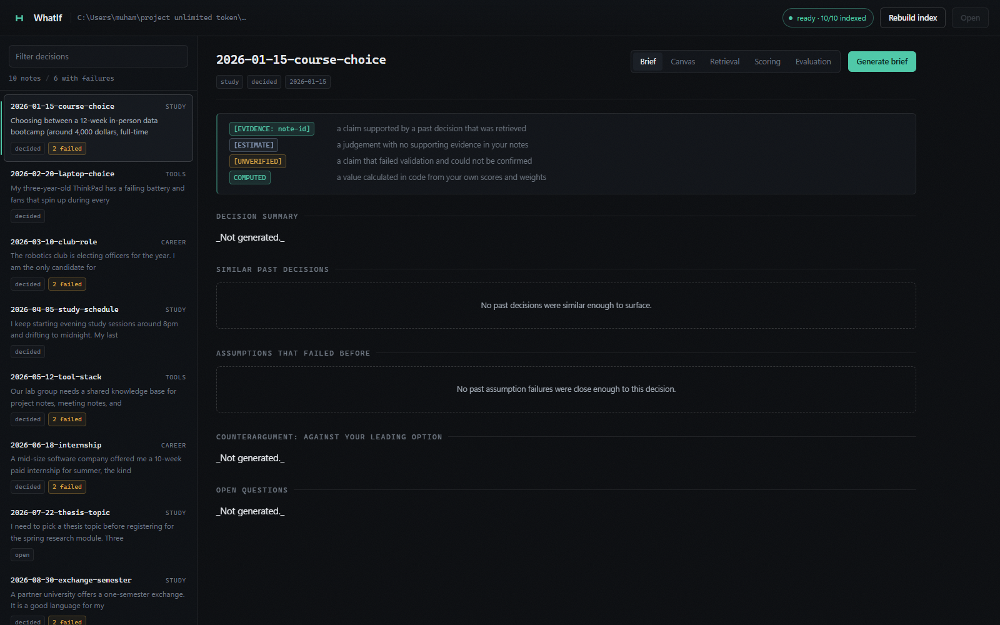
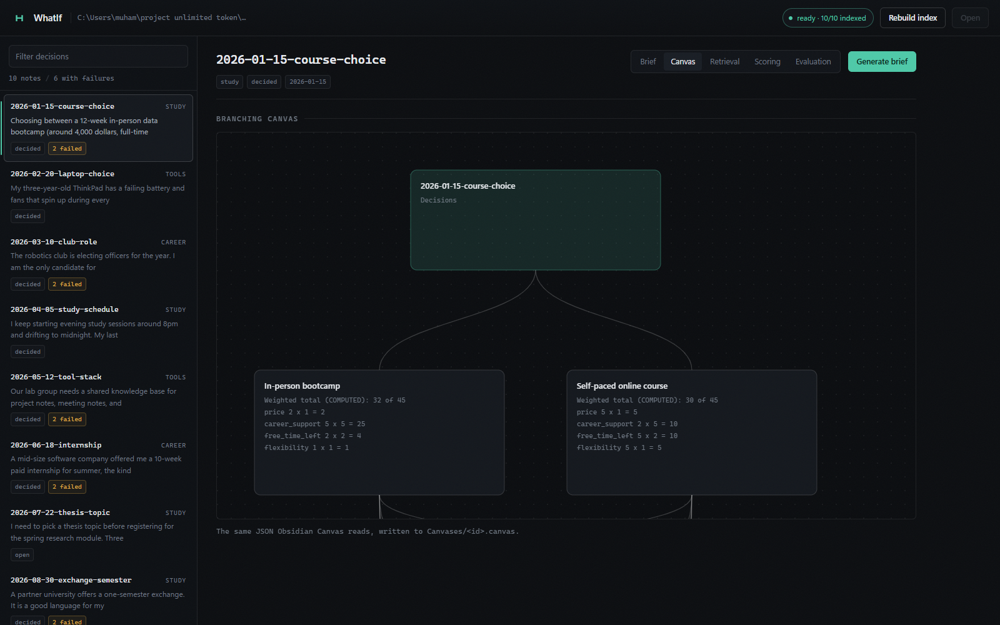
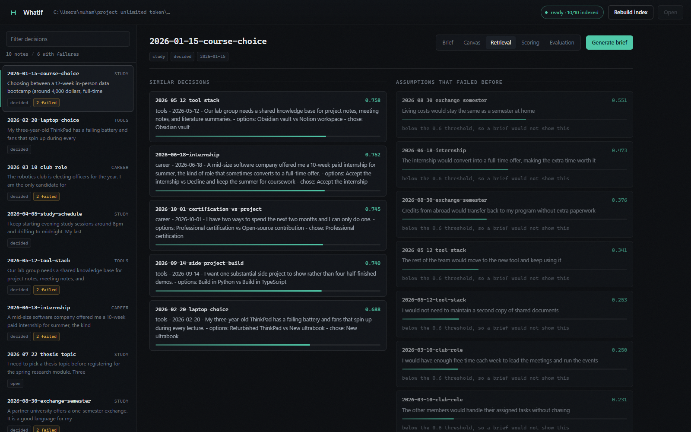
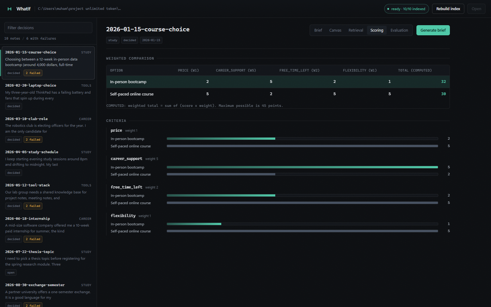
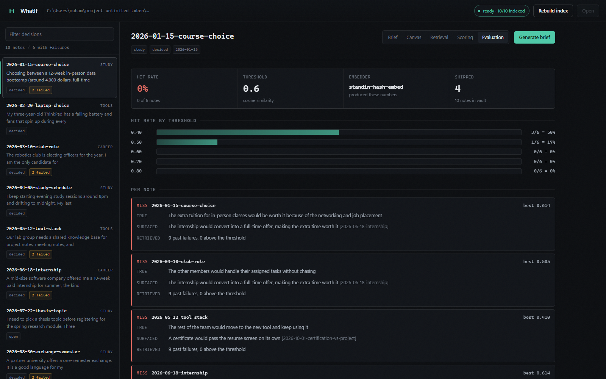

# WhatIf

**A local-first decision brief generator for Obsidian vaults.**

Write a decision into your vault. WhatIf finds the past decisions that resemble it,
surfaces the assumptions that failed before, computes the weighted comparison from
*your* scores, argues against the option you are leaning toward, and writes a brief
that labels every claim as evidence or estimate.

Everything runs on your machine. No accounts, no cloud calls, no telemetry. The only
network traffic is to a local Ollama server.

---

## The problem

I keep a vault of decision notes. Each one records what I chose, the criteria I
weighted, and what I assumed. Months later the notes are still there, but they are
unsearchable in the way that matters: I can find the note about the laptop, but I
cannot find *the assumption I made about the laptop that turned out to be wrong*.

So the same mistake gets made again. The evidence exists. It is just not in the
form I need when I am deciding.

WhatIf turns the vault into a source of warnings. It reads a new decision, finds
the notes that resemble it, and puts the past failures in front of me next to my
own numbers.

## Design rules the tool holds itself to

1. **The model never computes anything.** Scores, totals, rankings and similarity
   numbers are calculated in code and spliced into the output. The LLM only writes
   prose.
2. **Every claim is labelled.** Each sentence ends with `[EVIDENCE: note-id]` or
   `[ESTIMATE]`. A claim that cites a note which was not retrieved is rejected.
3. **No probabilities, ever.** No percentages, no chances, no "likely". A brief
   describes what happened, not how likely something is.
4. **The counterargument argues against you.** It targets the option you are
   leaning toward, and it is not allowed to agree with you by default.
5. **Unverifiable claims are marked, not hidden.** If a claim fails validation even
   after a retry, it is marked `[UNVERIFIED]` rather than quietly dropped.
6. **A number without its provenance is not a result.** The evaluation report names
   the embedding model that produced it.

## Architecture

```
                    ┌──────────────────────────────────────────┐
   vault/           │            whatif/ (Python)              │
   Decisions/  ───► │  notes.py    parse + strict validation   │
   Templates/       │  store.py    SQLite: notes + vectors     │
   Briefs/          │  embeddings.py  Ollama client only here │
   Canvases/        │  retrieve.py cosine, top-k, failures     │
   .whatif/         │  scoring.py   weighted comparison        │
                    │  brief.py     prompt + tag validation     │
                    │  canvas.py    Obsidian Canvas JSON        │
                    │  eval.py      leave-one-out harness       │
                    │  cli.py       argparse commands          │
                    │  webapp.py    local HTTP interface        │
                    └───────────────┬──────────────────────────┘
                                    │  HTTP, 127.0.0.1 only
                             ┌──────▼──────┐        ┌─────────────┐
                             │  Ollama     │        │  SQLite     │
                             │ llama3.1    │        │ .whatif/    │
                             │ nomic-embed │        │ index.sqlite│
                             └─────────────┘        └─────────────┘
```

The flow for a brief:

```
new note ──► parse ──► embed ──► retrieve top-k notes
                                  │
                                  ├──► failed assumptions from those notes
                                  │
                                  ├──► compute weighted table  (code, never the LLM)
                                  │
                                  └──► prompt the LLM with only the new note
                                       and the retrieved notes
                                          │
                                          └──► validate every tag (code)
                                                 ├── pass ──────────► brief
                                                 └── fail ──► retry once
                                                              └── fail ──► [UNVERIFIED]
```

## Setup

Requirements: Python 3.11+, and [Ollama](https://ollama.com) for the language and
embedding models.

```bash
pip install numpy python-frontmatter pytest

ollama pull llama3.1
ollama pull nomic-embed-text
```

## Usage

```bash
whatif init --vault ./vault          # create the folder structure and a config
whatif doctor --vault ./vault        # check Ollama, models and vault layout
whatif index  --vault ./vault        # parse and embed every decision note
whatif brief  2026-11-01-laptop      # write a brief
whatif canvas 2026-11-01-laptop      # write a branching Obsidian Canvas
whatif eval   --vault ./vault        # leave-one-out evaluation
whatif serve  --vault ./vault        # local web interface on :8765
```

Every command accepts `--vault`, `--config`, `-v/--verbose` and `--debug`.

### The local web interface

The fastest way in, if you do not have Ollama installed:

```bash
python scripts/demo.py
```

That starts a stand-in Ollama server, indexes the vault and serves the interface.
It detects a real Ollama already running and leaves it alone.

Or, with Ollama running:

```bash
whatif serve --vault ./vault --port 8765
```

Then open <http://127.0.0.1:8765>. It is a local console over the same pipeline the
CLI uses, with five views per decision: the brief, the branching canvas drawn as an
animated graph, the retrieval, the computed scoring, and the evaluation.

Keyboard: `/` focuses the filter, `j` / `k` move between decisions, `g` cycles tabs.



The brief is rendered from the same file that lands in `Briefs/`. Tags are colour
coded, the weighted table is marked `COMPUTED`, and the counterargument names the
option it is arguing against.



The canvas view draws the same JSON that Obsidian reads, but as an animated graph.
The root node is the decision, each option carries its computed total and criterion
breakdown, and the shared assumption and risk nodes sit below.



Retrieval shows the similarity of every candidate and marks which past failures
clear the threshold a brief would apply, so it is obvious what a brief would and
would not have shown.



The scoring view compares the options criterion by criterion. The leading option is
highlighted, which makes the trade-off visible: here the bootcamp wins the
weight-5 criterion and loses everything else.



The evaluation view names the embedder that produced the numbers, because a hit
rate without that context is not a result.

## The note format

```yaml
---
id: 2026-10-21-laptop-choice
type: decision
status: open            # open | decided
created: 2026-10-21
domain: tools           # study | career | money | tools | other
options: [Refurbished ThinkPad, New ultrabook]
chosen:
criteria:
  - {name: price, weight: 1}
  - {name: battery_life, weight: 5}
  - {name: repairability, weight: 2}
  - {name: performance, weight: 2}
scores:                 # 1-5 per option per criterion; 5 is always the best outcome
  Refurbished ThinkPad: {price: 5, battery_life: 3, repairability: 5, performance: 3}
  New ultrabook: {price: 2, battery_life: 5, repairability: 1, performance: 5}
assumptions: [The discount would still apply at checkout]
risks: [Soldered memory means no upgrades later]
outcome:
  reviewed_on:
  result:               # better | as-expected | worse
  failed_assumptions: []
tags: []
---
## Context
## Options
## Decision
## Outcome
```

**Scoring convention:** 5 always means *the best outcome for you on that criterion*.
Name criteria so the direction is obvious. `price` (5 = cheapest) and
`free_time_left` (5 = most time remaining) are unambiguous; `cost` is not, because
"5 on cost" could mean expensive or good.

The weighted total is `sum(score x weight)`. The maximum possible is
`5 x sum(weights)`.

## Example output

```markdown
# Decision brief: 2026-09-14-side-project-build

> **Legend**
> - `[EVIDENCE: note-id]` - a claim supported by a past decision that was retrieved
> - `[ESTIMATE]` - a judgement with no supporting evidence in your notes
> - `[UNVERIFIED]` - a claim that failed validation and could not be confirmed
> - `COMPUTED` - a value calculated in code from your own scores and weights
>
> WhatIf does not predict outcomes. Nothing here is a probability.

## Decision summary

The user is choosing between two options that differ mainly on price and speed [ESTIMATE]

## Similar past decisions

| Note | Similarity | Why it is relevant |
|---|---|---|
| `2026-05-12-tool-stack` | 0.758 | A past decision where the cheaper option lost for reasons that were not about price |

## Assumptions that failed before

- The rest of the team would move to the new tool and keep using it [EVIDENCE: 2026-05-12-tool-stack] (similarity 0.782)

## Weighted comparison

| Option | ecosystem (w3) | hiring_visibility (w3) | learning_value (w2) | speed_to_first_demo (w2) | **Total (COMPUTED)** |
|---|---|---|---|---|---|
| Build in TypeScript | 5 | 5 | 3 | 3 | **42** |
| Build in Python | 4 | 2 | 4 | 4 | **34** |

*COMPUTED: weighted total = sum of (score x weight). Maximum possible is 50 points.*

## Counterargument: against Build in TypeScript

A similar decision did not pay off the last time it was made [EVIDENCE: 2026-05-12-tool-stack]

## Open questions

What is the real budget once the second option is included? [ESTIMATE]
```

## The evaluation

`whatif eval` runs a leave-one-out test. For every decided note that has a failed
assumption, the note is excluded from the index, its outcome is hidden, and the
failed assumptions surfaced from the *other* notes are compared against the hidden
truth by cosine similarity. A hit is counted when a surfaced assumption is close
enough to one of the true ones.

The result on the shipped seed data, using the stand-in embedder described below:

```
Hit rate at threshold 0.60: 0/6 = 0%
Hit rate at other thresholds:
  0.40  3/6 = 50%
  0.50  1/6 = 17%
  0.60  0/6 = 0%
```

### What the evaluation actually showed

**The number is 0% at the default threshold, and the reason is the retrieval step,
not the matching step.**

For `2026-06-18-internship`, the best candidate surfaced was *"The extra tuition for
in-person classes would be worth it because of the networking and job placement"*
from `2026-01-15-course-choice`. Its similarity to the internship's true failure
(*"The internship would convert into a full-time offer, making the extra time worth
it"*) was **0.614** — above the 0.60 bar. But its similarity to the *new decision* was
0.596, just under it, so a brief would never have shown it.

That is the real finding: **the two filters measure different things, and the
query-side filter is the one that excludes the good matches.** Both are
cosine similarities, but one compares "this new decision" to "a past failure" and
the other compares "a past failure" to "another past failure". The first is harder,
because a new decision is phrased differently from a resolved one.

For `2026-05-12-tool-stack` and `2026-08-30-exchange-semester` there is no genuine
match anywhere in the vault. Those are true misses, and no amount of threshold
tuning would fix them.

**One failure case in detail.** `2026-01-15-course-choice` failed on *"The extra
tuition for in-person classes would be worth it because of the networking and job
placement"*. The most similar failure in the vault is the internship note's *"The
internship would convert into a full-time offer, making the extra time worth it"*.
Both are "a career investment will pay off" assumptions, and they are the closest
pair in the data. A reader would call that a hit. The harness called it a miss,
because the surfaced assumption's similarity to the *new decision* was 0.551, under
the threshold. The semantic content was right; the ranking was not.

### What I would improve

1. **Match on the failure, not on the decision.** The surfacing filter should compare
   a candidate failure against the new decision's *assumptions* specifically, not
   against the whole note body. The note body is context, and it dilutes the
   signal.
2. **Use a two-stage threshold.** The current design applies one number to two
   different comparisons. A lower bar for surfacing and a higher bar for counting a
   hit would separate "worth showing" from "counts as correct".
3. **Evaluate on more than six notes.** Six is too small for a percentage to mean
   much. The seed set exists to prove the pipeline works, not to measure quality.
4. **Report a second metric.** Hit rate alone does not say whether the failures
   were surfaced *too many* or *too few*. Precision and recall at the same threshold
   would say much more.

## Limitations

- **The published hit rate is not a benchmark.** Ollama was not available on the
  machine this was built on and there was no network access to install it, so the
  number above was produced by the stand-in embedder in `scripts/fake_ollama.py`:
  a bag-of-words hash, not a semantic model. The stand-in reports itself under the
  name `standin-hash-embed` rather than impersonating `nomic-embed-text`, and every
  report carries that name. Run `whatif eval` against real Ollama for a real number.
- **The seed data is invented.** Ten plausible decisions written to exercise the
  pipeline, not a record of real ones. The evaluation measures the harness against
  data I wrote, which is a weak test of retrieval quality.
- **Six notes are evaluable.** Two are still open, and two decided notes have no
  failed assumptions, so only six can be scored.
- **Embeddings are per-note, not per-chunk.** A long note produces one vector for
  its whole body, so a long note is diluted by its less relevant paragraphs.
- **Failed assumptions are matched individually.** A past failure that was phrased
  completely differently from the new assumption will not be found, no matter how
  similar the two situations were.
- **The LLM sees only the retrieved notes.** It cannot use knowledge from outside
  the vault, by design. It also cannot notice that a retrieved note is irrelevant.
- **One note, one embedding model.** Changing the embedder invalidates the index.
  `whatif doctor` and the evaluation both warn when the index and the config
  disagree.
- **The web interface is single user.** No authentication, no sessions, no
  concurrency control beyond one index run at a time. It binds to 127.0.0.1 only.
- **The web interface was not in the original scope.** The brief listed a web UI as
  a non-goal. It is a self-contained addition in `whatif/webapp.py` and
  `whatif/web/`; the CLI and the package are unaffected by it.

## Repository layout

```
whatif/                 the package
  config.py             TOML configuration, vault paths
  notes.py              parsing and strict validation
  embeddings.py         the only module that opens a network connection
  store.py              SQLite: notes, vectors, assumption vectors
  retrieve.py           cosine similarity, top-k, failed assumptions
  scoring.py            the weighted comparison, computed in code
  brief.py              prompt construction and tag validation
  canvas.py             Obsidian Canvas JSON
  eval.py               leave-one-out evaluation
  cli.py                argparse commands
  webapp.py             local HTTP interface
  web/                  the interface: index.html, styles.css, app.js
tests/                  pytest suite, 404 tests
  fixtures/decisions/   10 seed decision notes
scripts/
  fake_ollama.py        stand-in Ollama server for offline work
  inspect_*.py          small tools for looking at the output
vault/                  a working vault with the seed notes
docs/eval-results.json  the output of an evaluation run
```

## Development

```bash
python -m pytest tests/ -q     # 404 tests, no Ollama required
```

The suite never needs a model. A stand-in Ollama server bound to `127.0.0.1` covers
the paths that do, and the network guard test asserts that no module outside
`whatif/embeddings.py` opens a connection.

## Non-goals

No cloud APIs, no accounts, no outcome-probability model, no multi-user support.
