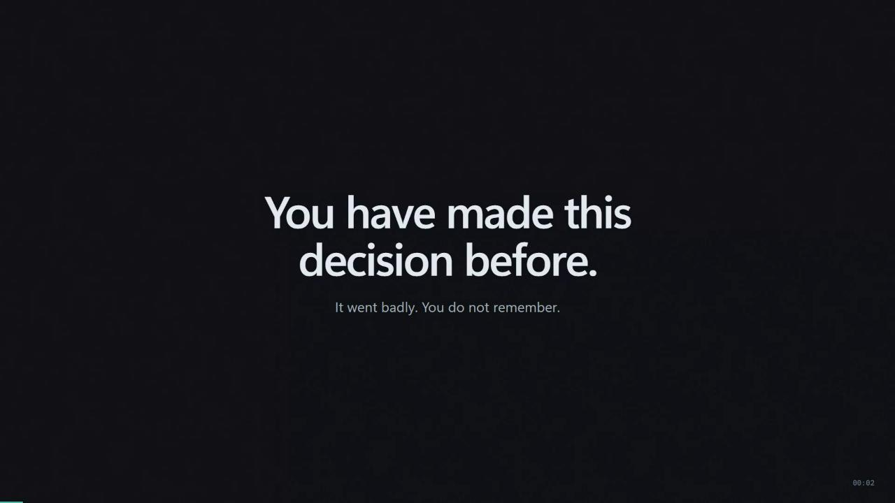

# WhatIf — promotional video

`whatif-promo.webm` is a 1 minute 45 second commercial for WhatIf, written for an
audience that has never heard of the tool and does not know what an embedding is.



## Why it is built this way

The piece is a **scripted motion-graphics commercial**, not a screen recording. A
screen recording of a terminal tool is unwatchable for a general audience: it is
full of file paths, CLI output and jargon.

So the story does the work:

- It opens on a feeling everybody recognises: *you have made this decision before,
  and it went badly.*
- It shows the product in three concrete steps, each one a thing a person can
  picture: find similar decisions, surface the failures, score your options.
- It makes the counterargument the turn, because "a tool that argues with you" is
  the idea, and it is stranger than the engineering.
- It closes on trust, which is the actual differentiator: every claim is labelled.

No jargon appears anywhere. The words *embedding*, *cosine similarity*, *vector*,
*retrieval* and *leave-one-out* are all absent from the script. The closest the
piece comes to a technical claim is "the model never invents a number".

The four product screenshots in the piece are real captures of the running
application, not mock-ups. The closing shot is the live application in an iframe.

## Storyboard

| Time | Scene | On screen | Words |
|---|---|---|---|
| 0:00 | Hook | Black, then large type | You have made this decision before. It went badly. You do not remember. |
| 0:08 | The problem | A cascade of real decision notes greying out, a search box typing a query that returns nothing | Your notes are all there. Every decision, every assumption you made, written down carefully. The one that would have helped you? You cannot find it. |
| 0:19 | The turn | A new decision note assembling line by line | WhatIf. It reads the decision you are making right now. |
| 0:28 | Step one | The retrieval view in a browser frame | It finds the past decisions that look like yours. Not by keyword. By what the decision was actually about. |
| 0:41 | Step two | Three failed-assumption cards, the middle one highlighted | Then it surfaces the assumptions that failed. |
| 0:56 | Step three | The scoring table with two animated bars | It scores your options using your own weights. The model never invents a number. Every total is calculated from the scores you wrote down. |
| 1:09 | Step four | The counterargument panel, typed out | And then it argues with you. It is not built to agree with you. |
| 1:20 | Trust | Four cards: evidence, estimate, computed, no percentages | Every sentence says where it came from. |
| 1:32 | Close | The wordmark, the tagline, the live app | WhatIf. Your past decisions, warning you about the next one. Runs entirely on your machine. |

Total running time: 1:45.

## Files

| File | What it is |
|---|---|
| `src.html` | The template for the scroll-based landing page. |
| `whatif-promo.html` | The built landing page. Every asset inlined, so it opens from `file://`. |
| `demo/` | The working interface as a static build, linked from the landing page's "Try the prototype" buttons. |
| `promo.html` | The commercial. One self-contained file: no build step, no CDN, no web fonts. |
| `whatif-promo.webm` | The rendered video, 1920x1080. |
| `poster.jpg` | The opening frame, used as the thumbnail. |
| `frames/` | Stills pulled from the finished video, for checking the result. |
| `playwright.config.json` | The browser settings used to record: a 1920x1080 viewport and a 1920x1080 video size. |
| `../scripts/extract_frames.py` | Pulls stills out of the video, because there is no ffmpeg on this machine. |

## Publishing the landing page

Two build steps, both idempotent:

```bash
python scripts/build_demo.py       # writes promo/demo/
python scripts/build_promo.py      # writes promo/whatif-promo.html
```

`build_promo.py` inlines every asset into a single HTML file, so the page opens
from `file://` and needs no build step on the reader's side. The one thing it
does not inline is `demo/index.html`: the landing page hands the reader a working
interface, and that folder has to ship next to the page.

Assemble a deploy folder **outside the repository**:

```
<deploy>/index.html    <- promo/whatif-promo.html
<deploy>/demo/         <- promo/demo/
```

Then run `vercel deploy --prod` from that folder.

The folder must sit outside the repo. Vercel refuses a deployment whose commit
author has no permission on the project, and this repository's author is
`Developer <dev@localhost>`, so a deploy from inside a worktree is blocked
outright. `scripts/publish_promo.py` writes `promo/site/` (gitignored) for hosts
that do not check the commit author.

## Checklist before publishing

- Run `python scripts/build_demo.py` first — `promo/demo/` does not exist until
  that step produces it, and the two "Try the prototype" buttons 404 without it.
- Open `promo/whatif-promo.html` from `file://` and click **Try the prototype**:
  the interface should load with 10 notes, a rendered brief, and no console
  errors. The demo is a static snapshot of the stand-in Ollama run, so it says
  so in a banner at the top of the page.

## Rebuilding it

```bash
# 1. Serve the repository so the promo can reach the screenshots and the app.
python -m http.server 8899

# 2. The app must be running for the closing shot.
python scripts/demo.py

# 3. Record.
playwright-cli open --config promo/playwright.config.json http://127.0.0.1:8899/promo/promo.html
playwright-cli video-start "promo/whatif-promo"
playwright-cli run-code "async page => { await page.reload({waitUntil:'domcontentloaded'}); return 'ok'; }"
# ... wait for the piece to run (1:45) ...
playwright-cli video-stop
```

The reload is what syncs the recording to the timeline: it restarts the piece on the
first frame of the video, so there is no blank lead-in.

## Checking the result

```bash
python scripts/extract_frames.py
```

This plays the video through in a browser and writes stills to `promo/frames/`. The
video has to be *played*, not seeked: Playwright writes WebM files with no seek
index, so `currentTime` does not move.

## Retiming the piece

Every beat is timed in one place, the `SCENES` list and the `at(...)` calls at the
bottom of `promo.html`. Change a number, reload the page, and the whole piece
retimes. `TOTAL` is the length of the progress bar.
